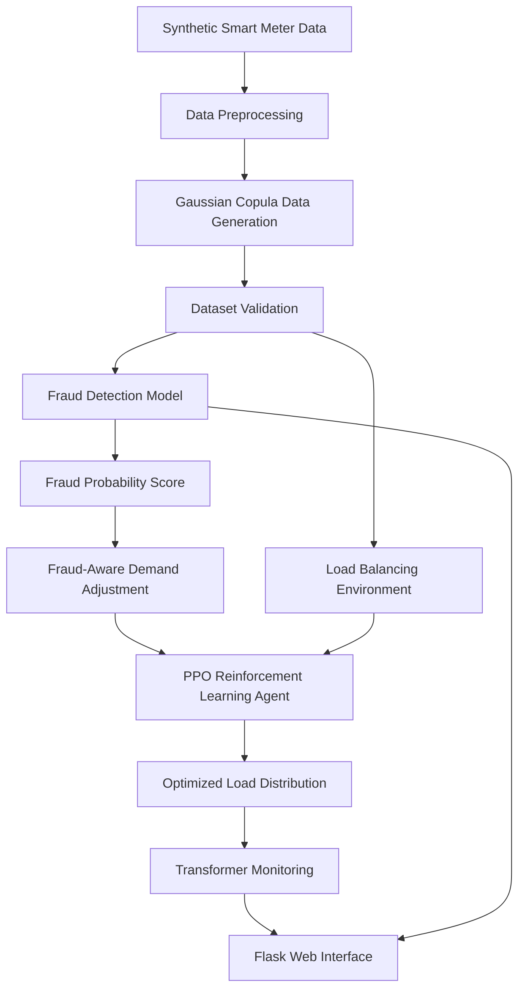

# ⚡ Self-Optimizing Power Grid
### AI for Real-Time Electricity Fraud Detection & Intelligent Load Balancing

An AI-driven smart grid framework that integrates Machine Learning and Reinforcement Learning to detect electricity theft, improve demand reliability, and optimize transformer load distribution in urban power networks.

---

## 📌 Overview

Electricity distribution networks in densely populated metropolitan cities face increasing challenges due to rising power consumption, electricity theft, inaccurate demand measurements, and transformer overloads.

Traditional grid management systems rely heavily on rule-based monitoring, periodic inspections, and conventional load scheduling techniques. These approaches often struggle to adapt to rapidly changing consumption patterns and fraudulent electricity usage.

**Self-Optimizing Power Grid** addresses these challenges through an integrated Artificial Intelligence framework that combines:

- Machine Learning-based electricity fraud detection.
- Gaussian Copula-based synthetic smart meter data generation.
- Proximal Policy Optimization (PPO) for intelligent load balancing.
- Fraud-aware demand adjustment for reliable grid control.
- A Flask-based interface for monitoring and interacting with the system.

The framework uses probabilistic fraud predictions to inform reinforcement learning decisions, allowing the load-balancing agent to account for potentially unreliable consumption measurements rather than treating every smart meter reading as trustworthy.

The project focuses on Mumbai-like urban electricity distribution scenarios and evaluates its performance through controlled experiments using synthetic datasets.

---

## 🎯 Project Objectives

1. **Electricity Fraud Detection:** Identify suspicious electricity consumption patterns using supervised machine learning.

2. **Synthetic Data Generation:** Generate statistically representative smart meter datasets while preserving relationships between electrical, environmental, and behavioural features.

3. **Intelligent Load Balancing:** Develop a reinforcement learning agent capable of making adaptive load distribution decisions.

4. **Fraud-Aware Grid Management:** Integrate fraud probability into the reinforcement learning state representation to account for potentially manipulated consumption data.

5. **Transformer Protection:** Reduce transformer overload occurrences and encourage safe operating conditions.

6. **Interactive Monitoring:** Develop a web-based interface for accessing fraud detection, load balancing, forecasting, and grid monitoring functionalities.

---

## 🏗️ System Architecture

The proposed framework follows an integrated pipeline consisting of data generation, fraud detection, reinforcement learning, and system-level interaction.



### Architecture Components

| Component | Purpose |
|---|---|
| Synthetic Data Generation | Creates smart meter and grid datasets. |
| Gaussian Copula | Preserves marginal distributions and inter-feature dependencies. |
| Fraud Detection | Predicts the probability of electricity theft. |
| Fraud-Aware Integration | Adjusts measured demand based on predicted fraud probability. |
| PPO Agent | Learns adaptive load distribution policies. |
| Grid Simulation | Evaluates transformer loading and grid operating conditions. |
| Flask Interface | Provides interactive access to the system. |
| SQLite | Stores application user information. |

---

## 🧠 Core Modules

### 1. Synthetic Smart Meter Data Generation

Real-world smart meter datasets are difficult to obtain because of consumer privacy, utility security, and regulatory restrictions. Additionally, verified electricity theft records are relatively scarce.

To address these limitations, the project employs synthetic data generation using a Gaussian Copula-based approach.

The approach consists of two major stages:

**Marginal Distribution Modelling**

Individual feature distributions are modelled to reproduce the statistical characteristics of the selected electrical and behavioural variables.

**Dependency Modelling**

A correlation structure is learned to preserve relationships between variables, allowing the generated data to retain meaningful inter-feature dependencies.

The generated datasets support two separate learning tasks:

- Fraud Detection Dataset: Structured for supervised classification.
- Load Balancing Dataset: Structured as time-ordered observations for sequential decision-making.

#### Evaluated Synthetic Data Generation Techniques

The experiments compare Gaussian Copula with CopulaGAN.

| Evaluation Metric | Gaussian Copula | CopulaGAN |
|---|---:|---:|
| Column Shape Score | 95.43% | 84.60% |
| Column Pair Trends Score | 93.89% | 78.70% |
| Overall Quality Score | 94.66% | 81.65% |

**Experimental Observation:** Gaussian Copula achieved a higher overall quality score and better preservation of both individual feature distributions and inter-feature relationships in the reported evaluation.

---

### 2. Electricity Fraud Detection

The fraud detection module identifies potentially fraudulent electricity consumption using supervised machine learning.

The classification problem consists of two categories:

- Normal electricity consumption.
- Fraudulent electricity consumption.

#### Input Features

The model uses electrical, behavioural, and contextual attributes.

| Feature Category | Parameters |
|---|---|
| Electrical Parameters | Voltage, Current, Active Power, Reactive Power, Load Demand |
| Behavioural Indicators | Neighbourhood Consumption Deviation, Load Spike Flag, Zero Consumption Flag, Occupancy Level |
| Contextual Attributes | Household Type, Appliance Usage Category |

The classification model produces a probability score representing the likelihood of fraudulent consumption.

Unlike a simple rule-based detection mechanism, the model uses learned relationships between the input features to estimate fraud probability.

#### Model Evaluation

The fraud detection experiments report the following performance:

| Metric | Threshold 0.5 | Threshold 0.62 |
|---|---:|---:|
| PR-AUC | 0.824 | 0.824 |
| ROC-AUC | 0.839 | 0.839 |
| Log Loss | 0.487 | 0.487 |
| F1-Score | 0.799 | 0.797 |
| Precision | 79.92% | 80.12% |
| Recall | 79.92% | 79.31% |

**Reported classification accuracy: 79.91%.**

#### Threshold Selection

Two classification thresholds were evaluated.

- **0.5:** Provides slightly higher recall.
- **0.62:** Provides improved precision with a small reduction in recall.

The threshold of 0.62 was selected as the preferred operating point to reduce unnecessary inspections while maintaining comparable fraud detection coverage.

The probability output is also retained for downstream integration with the reinforcement learning module.

---

### 3. Reinforcement Learning-Based Load Balancing

The load-balancing component is formulated as a Markov Decision Process (MDP).

The objective is to learn adaptive control policies that distribute electrical demand while considering transformer capacity, renewable contribution, and changing consumption conditions.

#### Algorithm: Proximal Policy Optimization (PPO)

PPO is used as the reinforcement learning algorithm because it supports continuous action spaces and uses a clipped policy objective to constrain large policy updates.

The implementation uses:

- Python.
- Gymnasium-based custom environment.
- Stable-Baselines3.
- Proximal Policy Optimization.

#### State Space

The reinforcement learning agent observes a combination of electrical and contextual information.

| State Parameter | Description |
|---|---|
| Load Demand | Measured electrical demand. |
| Transformer Utilization | Current transformer loading percentage. |
| Fraud Probability | Predicted likelihood of fraudulent consumption. |
| Renewable Contribution | Available renewable energy contribution. |
| Temporal Features | Hour and day information. |
| Environmental Context | Seasonal and weather-related factors. |

#### Action Space

The agent operates using continuous load-adjustment actions.

These actions represent incremental load redistribution decisions intended to maintain safe transformer operating conditions and reduce peak stress.

#### Reward Function

The reward function encourages the agent to balance grid safety, operational efficiency, and renewable energy utilization.

| Operating Condition | Reward Behaviour |
|---|---|
| Transformer Overload | Strong penalty |
| Near-Capacity Operation | Mild penalty |
| Transformer Loading within 60–80% | Positive reward |
| Renewable Energy Utilization | Positive incentive |
| Frequency Deviations | Penalty |
| Excessive Load Fluctuations | Penalty |
| Peak-Hour Operation | Penalty |

The reward coefficients reported in the manuscript are:

| Parameter | Value |
|---|---:|
| Safety coefficient | 1.0 |
| Overload penalty coefficient | 2.0 |
| Instability coefficient | 0.5 |
| Renewable utilization coefficient | 0.8 |

---

### 4. Fraud-Aware Load Balancing Integration

The primary contribution of the proposed framework is the integration of fraud detection with reinforcement learning-based grid control.

Conventional load-balancing approaches generally assume that the incoming consumption measurements are reliable.

However, manipulated meter readings can distort the demand information supplied to grid management systems.

To address this issue, the proposed framework incorporates the predicted fraud probability into the effective demand calculation.

The fraud-adjusted demand is represented as:

The fraud-adjusted demand is represented as:

$$
L_{\text{effective}}(t) = L_{\text{measured}}(t) \times (1-f_t)
$$

Where:

- $L_{\text{effective}}(t)$ represents the adjusted demand.
- $L_{\text{measured}}(t)$ represents the measured demand.
- $f_t$ represents the predicted fraud probability.

The resulting effective demand is incorporated into the reinforcement learning state representation.

This probabilistic adjustment allows the system to downweight suspicious readings instead of relying exclusively on binary fraud classification.

**Important:** This equation is the framework's proposed reliability-weighting mechanism. It does not independently reconstruct the actual electricity consumed by a fraudulent household. Its effectiveness is therefore evaluated within the simulated environment.

---

## 📊 Experimental Results

The framework is evaluated through synthetic data quality assessment, fraud detection experiments, and reinforcement learning-based load-balancing experiments.

### Synthetic Data Quality

Gaussian Copula achieved an overall quality score of **94.66%**, compared with **81.65%** for CopulaGAN.

### Fraud Detection

The reported fraud detection accuracy is **79.91%**.

Additional evaluation metrics include:

- PR-AUC: 0.824.
- ROC-AUC: 0.839.
- F1-score: 0.799 at threshold 0.5.
- Precision: 80.12% at threshold 0.62.
- Recall: 79.31% at threshold 0.62.

### Load Balancing

The reinforcement learning experiments evaluate:

- Transformer overload occurrences.
- Peak transformer loading.
- Load distribution over time.
- Grid stability.
- Reward convergence.
- Decision-making latency.

The manuscript reports a **35–45% reduction in transformer overloads** in Mumbai-like synthetic scenarios.

The reported decision-making latency is 0.5–1.0 seconds per iteration.

These findings are based on controlled simulation experiments, not a live deployment on Mumbai's electricity distribution infrastructure.

---

## 🖥️ Web Application

The project includes a Flask-based web application called **Mumbai Smart Energy**.

The interface provides access to the different functionalities of the proposed framework.

### Application Modules

| Module | Functionality |
|---|---|
| Home | Introduction and overview of the smart grid framework. |
| Fraud Detection | Identifies suspicious electricity consumption. |
| Fraud Detection Pro | Provides an extended fraud detection interface. |
| Load Balancing | Displays intelligent load distribution functionality. |
| Load Balancing Pro | Provides an extended load-balancing interface. |
| Dashboard | Displays grid monitoring information and visualizations. |
| Renewables | Provides renewable energy-related information. |
| Forecast | Displays electricity demand forecasting functionality. |
| Alerts | Displays system alerts. |
| Login / Logout | Handles application user authentication. |

### Dashboard Visualization

The dashboard includes monitoring and visualization elements for the simulated distribution zones:

- BEST Central.
- Adani West.
- Tata South.
- MSEDCL Suburbs.

The application uses Bootstrap-based frontend components and interactive visualizations.

---

## 🛠️ Technology Stack

| Category | Technologies |
|---|---|
| Programming Language | Python |
| Machine Learning | Scikit-learn |
| Synthetic Data Generation | Gaussian Copula |
| Reinforcement Learning | Stable-Baselines3, PPO |
| RL Environment | Gymnasium |
| Backend | Flask |
| Database | SQLite |
| Data Processing | Pandas, NumPy |
| Model Persistence | Joblib |
| Frontend | HTML, CSS, JavaScript, Bootstrap |
| Visualization | Interactive charts and maps |
| Development Environment | Python Virtual Environment |

The current application uses locally deployed model artifacts rather than requiring an active Google Cloud deployment.

---

## 📁 Project Structure

The following represents the main application components and model artifacts. Adjust the paths to match the final repository structure.

```text
Self-Optimizing-Power-Grid/
│
├── app.py
│
├── templates/
│   ├── home.html
│   ├── dashboard.html
│   ├── fraud_detection.html
│   ├── fraud_detection_pro.html
│   ├── load_balancing.html
│   ├── load_balancing_pro.html
│   ├── renewables.html
│   ├── forecast.html
│   ├── alerts.html
│   └── login.html
│
├── static/
│   ├── css/
│   ├── js/
│   └── images/
│       └── mumbai_skyline.jfif
│
├── models/
│   ├── fraud_model_local.joblib
│   ├── scaler.joblib
│   ├── encoders.joblib
│   └── blackout_model.joblib
│
├── data/
│   ├── fraud_detection_dataset.csv
│   └── load_balancing_dataset.csv
│
├── database/
│   └── users.db
│
├── notebooks/
│   └── experiments/
│
├── requirements.txt
├── .gitignore
└── README.md
```

*Note: The directory tree is a suggested documentation structure, not a claim that every directory or filename currently exists in the repository.*

---

## ⚙️ Installation and Setup

### Prerequisites

Ensure that the following are installed:

- Python 3.10 or a compatible Python version.
- Git.
- pip.
- A code editor such as Visual Studio Code.

### Step 1: Clone the Repository

```bash
git clone <YOUR_GITHUB_REPOSITORY_URL>
```

Navigate to the project directory:

```bash
cd Self-Optimizing-Power-Grid
```

### Step 2: Create a Virtual Environment

On Windows:

```powershell
python -m venv venv
```

Activate the environment:

```powershell
.\venv\Scripts\Activate
```

On Linux/macOS:

```bash
python3 -m venv venv
source venv/bin/activate
```

### Step 3: Install Dependencies

If a requirements file is available:

```bash
pip install -r requirements.txt
```

Otherwise, install the dependencies specified by the application's imports and experiment scripts.

### Step 4: Configure Model Files

Ensure that the required trained model artifacts are available in the paths expected by the application.

The current implementation uses locally stored model files, including:

```text
fraud_model_local.joblib
scaler.joblib
encoders.joblib
blackout_model.joblib
```

Do not rename or relocate these files without updating their corresponding loading paths in the application.

### Step 5: Run the Application

Run the Flask entry-point file:

```bash
python app.py
```

If your Flask entry point has a different filename, substitute its actual name.

Open the local development URL displayed in the terminal.

---

## 📈 Evaluation Metrics

The project uses different evaluation criteria for each component.

### Fraud Detection Metrics

| Metric | Purpose |
|---|---|
| Accuracy | Measures overall classification correctness. |
| Precision | Measures the proportion of predicted fraudulent cases that are fraudulent. |
| Recall | Measures the proportion of fraudulent cases correctly identified. |
| F1-Score | Balances precision and recall. |
| ROC-AUC | Measures classification discrimination across thresholds. |
| PR-AUC | Evaluates precision-recall performance, particularly relevant to imbalanced classification. |
| Log Loss | Evaluates the quality of predicted probabilities. |

### Synthetic Data Evaluation

| Metric | Purpose |
|---|---|
| Column Shape Score | Measures similarity between individual feature distributions. |
| Column Pair Trends Score | Measures preservation of relationships between feature pairs. |
| Overall Quality Score | Summarizes the synthetic data quality evaluation. |

### Reinforcement Learning Evaluation

The load-balancing agent is evaluated using:

- Mean episodic reward.
- Transformer overload occurrences.
- Peak transformer utilization.
- Load distribution stability.
- Renewable energy utilization.
- Decision-making latency.

---

## 🔬 Research Contributions

The proposed framework focuses on the following contributions:

**1. Integrated Fraud Detection and Load Balancing**

Instead of treating electricity theft detection and load optimization as independent problems, the framework connects their outputs within a unified control pipeline.

**2. Probabilistic Fraud-Aware State Representation**

The predicted fraud probability is incorporated into the RL state construction, allowing the agent to account for uncertainty in consumption measurements.

**3. Statistical Synthetic Data Generation**

Gaussian Copula-based data generation is evaluated for preserving marginal distributions and inter-feature dependencies in smart grid datasets.

**4. Reinforcement Learning-Based Grid Optimization**

PPO is used to learn continuous load adjustment policies while considering transformer operating conditions and renewable energy contribution.

**5. Urban Grid Simulation**

The experiments use Mumbai-inspired synthetic grid scenarios to study the potential of integrated AI-driven grid management.

---

## ⚠️ Limitations

The following limitations should be considered when interpreting the experimental results:

1. **Synthetic Data:** The framework is evaluated using synthetic smart meter and grid datasets rather than operational utility data from Mumbai.

2. **Simulation-Based Validation:** Transformer overload improvements are obtained from controlled simulation scenarios and do not establish equivalent improvements in a deployed electricity distribution network.

3. **Fraud Label Dependence:** The supervised fraud detection model depends on the quality of synthetic fraud labels and the assumptions used to construct them.

4. **Demand Adjustment Assumption:** Fraud probability-based demand adjustment is a reliability-weighting mechanism and does not provide an independently verified estimate of actual electricity consumption.

5. **Deployment Validation:** Real-world deployment would require integration with utility infrastructure, operational smart meters, communication systems, and physical grid safety mechanisms.

6. **Generalization:** Further testing with real-world datasets and different geographical distribution networks is required to establish generalization.

---

## 🚀 Future Scope

Potential directions for further development include:

- Validation using real-world smart meter datasets obtained through authorized utility partnerships.
- Exploration of advanced fraud detection architectures and comparative model evaluation.
- Improved temporal synthetic data generation for sequential grid behaviour.
- Integration of explainable AI techniques for better interpretation of suspicious consumption patterns.
- Advanced reinforcement learning approaches for multi-transformer and multi-zone optimization.
- Development of stronger safety-constrained RL policies.
- Integration with real-time IoT smart meter streams.
- Further evaluation of renewable energy integration and demand response strategies.
- Deployment on scalable infrastructure for utility-level applications.

---

## 🌍 Sustainable Development Goals

The project supports the objectives of:

**SDG 7 – Affordable and Clean Energy**

Promotes efficient energy distribution, responsible energy utilization, and intelligent grid management.

**SDG 11 – Sustainable Cities and Communities**

Explores AI-driven approaches to improve urban electricity infrastructure reliability and resilience.

---

## 👩‍💻 Development and Research

Developed as a final-year B.Tech Computer Science and Engineering (Artificial Intelligence and Machine Learning) major project.

The work explores the integration of supervised machine learning, statistical synthetic data generation, and reinforcement learning for intelligent electricity distribution management.

**Research Domain:** Artificial Intelligence, Machine Learning, Smart Grids, Reinforcement Learning, Energy Analytics.

---

## 📄 Disclaimer

This project is an academic research and development implementation.

All reported experimental findings are based on synthetic datasets and controlled simulation environments. The framework has not been validated through live deployment on Mumbai's electricity distribution network.

The reported performance values should therefore be interpreted within the scope of the experiments and assumptions described in the accompanying research manuscript.

---

## ⭐ Acknowledgements

This project was developed through academic research and experimentation in AI-driven energy management, with a focus on improving the reliability and efficiency of urban smart grid systems.

If you find this project interesting, consider exploring the repository and its research contributions.

**Building smarter, safer, and more adaptive energy systems through Artificial Intelligence.**
